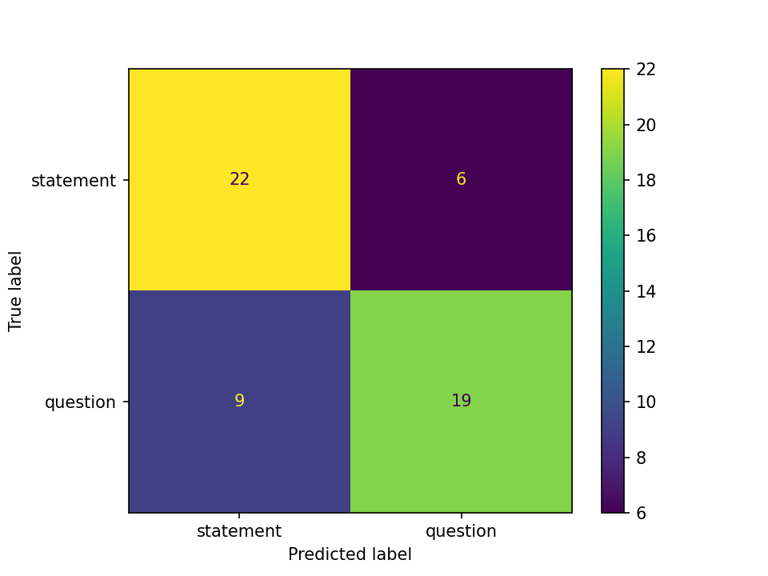
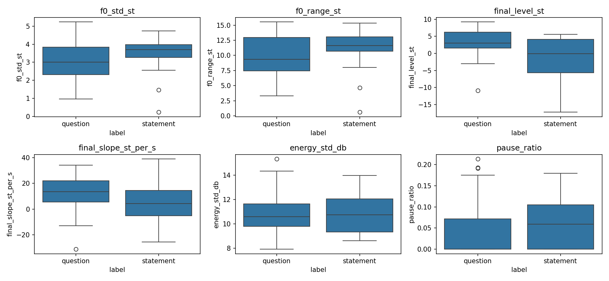
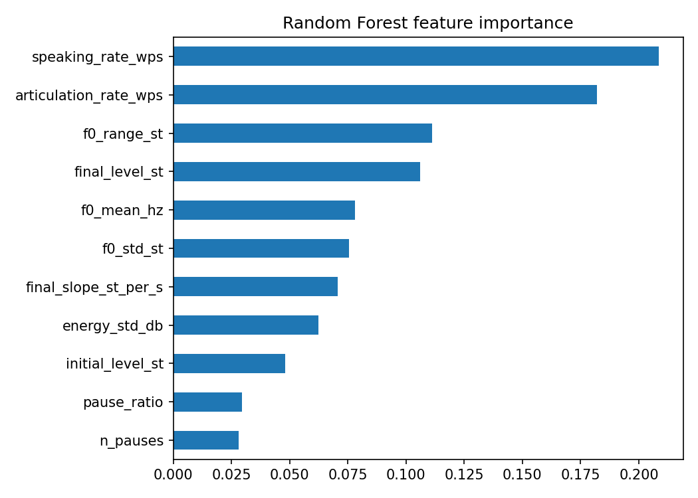

# Statement vs. Question Classifier from Prosody

Classifies an English utterance as a **question** or a **statement** using only prosodic features (pitch, energy, pauses, rate), with no text input.

## Dataset
LJ Speech (single English speaker). Labels come from transcript punctuation (`?` vs `.`). To stop sentence length from leaking the label, each question is paired with a statement of the **same word count**, giving a balanced set of **56 clips (28 questions, 28 statements)**.

## Features (11 per clip)
`f0_mean_hz`, `f0_std_st`, `f0_range_st`, `initial_level_st`, `final_level_st`, `final_slope_st_per_s` (pitch slope over the last 400 ms of voiced speech), `energy_std_db`, `n_pauses`, `pause_ratio`, `speaking_rate_wps`, `articulation_rate_wps`.
Pitch is extracted with pYIN and expressed in semitones relative to the clip median, so absolute pitch does not matter.

## Models and evaluation
5-fold stratified cross-validation; the majority-class baseline is 50%.

| Model | Accuracy (5-fold CV) |
|---|---|
| Logistic Regression | XX% ± XX |
| Random Forest | ~73% (41/56 correct, from the pooled cross-validated predictions) |
| RF, final-pitch features only | XX% ± XX |

### Confusion matrix (Random Forest, cross-validated)

| | Predicted statement | Predicted question |
|---|---|---|
| True statement | 22 | 6 |
| True question | 9 | 19 |

Statement recall is 79% (22/28) and question recall is 68% (19/28).

### Feature differences

Questions end at a higher pitch level (`final_level_st`, median about +3 vs about 0 st) and with a more positive final slope (median about +13 vs about +4 st/s) than statements. Questions also have slightly lower pitch variability (`f0_std_st`, `f0_range_st`). Energy variation and pause ratio barely differ between the classes.

### Feature importance

Speaking rate and articulation rate had the highest Random Forest importance, ahead of the pitch features. Clips were matched by word count, but duration can still differ between classes, and with only 56 clips these importances are noisy. The boxplots show the expected end-of-utterance pitch effect, but the rate features may be partly capturing dataset-specific differences.

## Limitations
- Very small dataset: only 28 questions passed the 4-15 word filter.
- One speaker reading audiobooks, so the results do not generalize to other speakers, conversational speech or other languages.
- Many English questions (especially wh-questions) do not rise in pitch, which caps accuracy for any pitch-based method.
- Accuracy varies across folds at this sample size.

## Run it
Open `Project_B_Prosody_Classifier.ipynb` in Google Colab (CPU runtime) and run all cells (about 15 minutes, mostly dataset download and feature extraction).

## Possible next steps
More clips and a held-out test set, a yes/no vs wh-question breakdown, and extending the approach to Tamil/Hindi.
